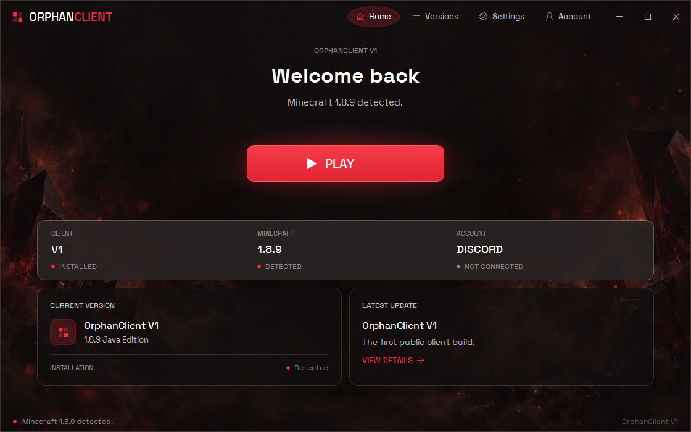
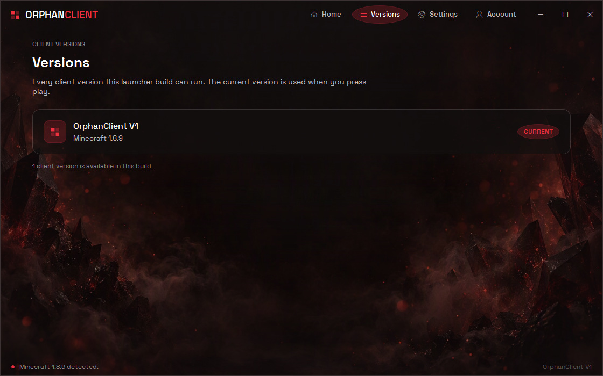
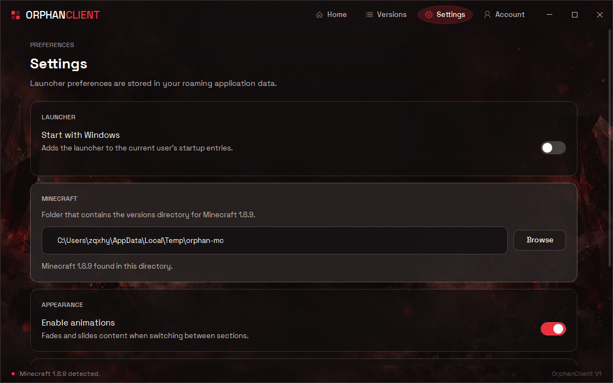
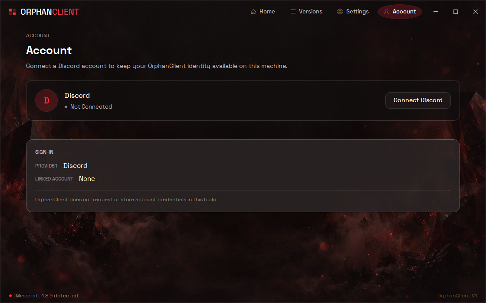
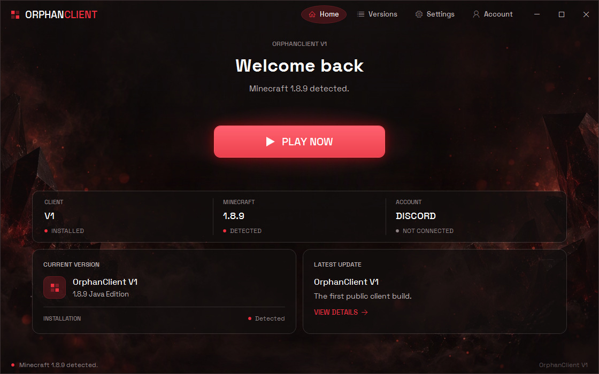
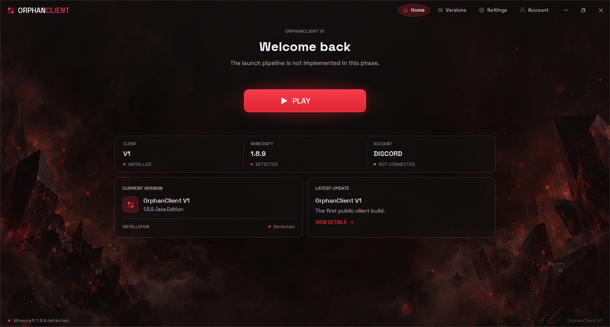

# OrphanClient Launcher

Desktop launcher for **OrphanClient V1**, a client for Minecraft Java Edition 1.8.9.

Built with C# on .NET 8 and WPF, with a hand-written visual system and no third-party UI dependencies.



## Contents

- [Overview](#overview)
- [Screenshots](#screenshots)
- [Features](#features)
- [Project status](#project-status)
- [Tech stack](#tech-stack)
- [Requirements](#requirements)
- [Getting started](#getting-started)
- [Project structure](#project-structure)
- [Configuration](#configuration)
- [Design](#design)
- [Licence](#licence)
- [Third-party notices](#third-party-notices)

## Overview

OrphanClient Launcher is the desktop entry point for OrphanClient V1. It locates a Minecraft
1.8.9 installation on the machine, reports the state of the launch pipeline, and exposes the
launcher's own preferences. It is the companion application to the OrphanClient C++ client.

The launcher is deliberately transparent about what it can and cannot do: it never reports a
successful launch, a connected account or a downloaded update that did not actually happen.
Every status shown in the interface is derived from real state on disk.

## Screenshots

| Versions | Settings |
| :---: | :---: |
|  |  |
| **Account** | **Launch button — hover** |
|  |  |

<details>
<summary>Maximised window</summary>



</details>

## Features

- **Custom window frame** with dragging, resizing, minimise, maximise and restore, and
  per-monitor DPI awareness. Maximising clamps to the monitor work area rather than the full
  monitor, so the taskbar stays visible.
- **Four sections** — Home, Versions, Settings and Account — reached from pills in the title
  bar, with an optional fade and slide transition.
- **Minecraft detection** — checks a configured directory for a `versions\1.8.9` folder and
  reports whether the installation is present.
- **Launch button with real state** — reports `PLAY`, `UNAVAILABLE` or `CHECKING` from the
  launch coordinator, with hover and pressed feedback.
- **Persistent settings** — window size, maximised state, animations and the Minecraft
  directory are stored as JSON.
- **Optional per-user startup registration**, applied through the current user's registry hive
  and verified after being written.
- **File logging** of launcher activity.

## Project status

This is a launcher shell, not a finished product. The following are **not implemented**:

- Starting Minecraft. The launch button reports the state of the pipeline instead of launching
  a game.
- Client download, update or repair. The Versions section lists the versions compiled into this
  build.
- Discord sign-in. The Account section always reports a disconnected state and never requests
  credentials.

These are intentional gaps rather than defects. The interface is built so that the remaining
work can be added without redesigning it.

## Tech stack

| | |
| --- | --- |
| Language | C# 12 |
| Runtime | .NET 8 (`net8.0-windows`) |
| UI framework | WPF (Windows Presentation Foundation) |
| Project format | SDK-style (`Microsoft.NET.Sdk`) |
| Test framework | xUnit |
| Third-party UI libraries | None |

## Requirements

- Windows 10 or later
- [.NET 8 SDK](https://dotnet.microsoft.com/download/dotnet/8.0)
- An IDE with the **.NET desktop development** workload, or the `dotnet` CLI

## Getting started

Clone the repository and build the solution:

```
git clone https://github.com/g0ewqq/OrphanClient.Launcher.git
cd OrphanClient.Launcher
dotnet build OrphanClient.Launcher.sln -c Debug
```

### Run

```
dotnet run --project src/OrphanClient.Launcher
```

Or launch the built executable directly:

```
src\OrphanClient.Launcher\bin\Debug\net8.0-windows\OrphanClient.Launcher.exe
```

### Test

```
dotnet test OrphanClient.Launcher.sln
```

## Project structure

```
OrphanClient.Launcher/
├── assets/                             Embedded fonts and imagery
│   ├── Fonts/                          Space Grotesk (SIL OFL 1.1) and its licence
│   └── Images/                         Background artwork
├── docs/screenshots/                   Images used by this README
├── src/
│   ├── OrphanClient.Launcher/          The WPF application
│   │   ├── Accounts/                   Account provider abstraction
│   │   ├── App/                        Application entry point
│   │   ├── Configuration/              Settings model and JSON store
│   │   ├── Core/                       Product metadata, paths, logging, launch coordinator
│   │   ├── Minecraft/                  Installation detection
│   │   ├── Services/                   Service composition and startup registration
│   │   └── UI/                         Window, pages and the theme dictionaries
│   └── OrphanClient.Launcher.Tests/    Automated tests for the non-UI layers
├── OrphanClient.Launcher.sln
├── LICENSE
└── README.md
```

## Configuration

| Path | Purpose |
| --- | --- |
| `%APPDATA%\OrphanClient\Launcher\settings.json` | Launcher preferences |
| `%LOCALAPPDATA%\OrphanClient\Launcher\logs\launcher.log` | Activity log |

Settings are written as JSON and read defensively: a malformed file is reported and replaced by
defaults rather than preventing the launcher from starting.

## Design

The interface is a warm near-black shell with a single crimson accent, laid over a full-bleed
atmospheric image. A dark base gradient, an ember glow and four edge scrims keep text legible
over the artwork without flattening it.

Layout uses one centred content column, so the same composition holds from the minimum window
size up to a maximised display. Typography is
[Space Grotesk](https://github.com/floriankarsten/space-grotesk) across a defined type scale.

Reusable styling lives in `src/OrphanClient.Launcher/UI/Theme`, merged in this order:

| Dictionary | Contents |
| --- | --- |
| `Colors.xaml` | Palette, accent fills, scrims and the spotlight brush |
| `Typography.xaml` | Font families and the type scale |
| `Surfaces.xaml` | Panels, tiles, chips, hairlines and the brand mark |
| `Controls.xaml` | Buttons, navigation pills, toggles, text fields and scrollbars |

## Licence

OrphanClient Launcher is proprietary software. All rights reserved.

The source code is made available for reference and evaluation only. No licence is granted to
copy, modify, redistribute or create derivative works from it. See [`LICENSE`](LICENSE) for the
full terms.

## Third-party notices

| Asset | Licence |
| --- | --- |
| Space Grotesk (`assets/Fonts/SpaceGrotesk-*.ttf`) | SIL Open Font License 1.1 — see `assets/Fonts/OFL.txt` |
| `assets/Images/background.jpg` | Original artwork created for this project |

These components are distributed under their own terms and are not covered by the project
licence.

OrphanClient is not affiliated with, endorsed by or sponsored by Mojang Studios or Microsoft
Corporation. "Minecraft" is a trade mark of Mojang Studios.
